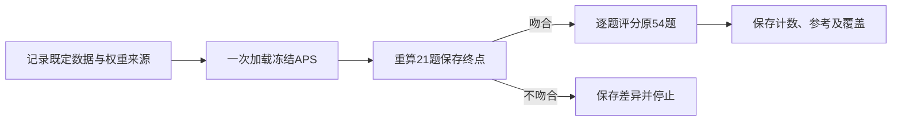

# M-APS固定权重的54题辅助预测设计

预定协议：2026-10-11。当前状态：入口已实现，一次固定权重评估及保存记录审计已完成。21题恢复评分与原终点差异0，原54题辅助预测全部正确；详见[实际结果](assisted-point-transfer-results.md)。后继已定稿为[APS起步Q／K训练设计](aps-warm-qk-design.md)，尚未实现或运行。

以下“总览”至“实施依赖与阶段边界”保留运行前协议原文；其中未来时态和“尚未测量”描述制定协议时的状态，不代表当前进度。数据、指标、容差和停止条件未在看过结果后调整；历史解释句以实际结果报告的最新解释为准。

## 总览

| 项目 | 约定 |
|---|---|
| 唯一问题 | 已在21题上拟合的冻结APS权重，在原54道验证题上的辅助选点预测表现如何？ |
| 数据 | 沿用现有original54：3盘棋、18局面，空／黑／白各18题，轮黑／轮白各27题 |
| 操作 | 一次加载，先恢复评分21训练题，再逐题评分54验证题；不训练、不生成新题 |
| 预算 | 一个本地进程，300秒软总预算含加载、核对、评分和保存；实际耗时尚未测量 |
| 输出 | 答对数、三类混淆矩阵、每盘及每行棋方计数、两种CE、覆盖和数值状态 |
| 边界 | 只描述这份既定列表的辅助预测，不证明自然选点、内部读取机制或泛化 |

## 数据和固定条件

从`outputs/grounding-data/manifest.json`的`original_occupancy_questions`取`split == "val"`，沿用原有54题及原顺序，不新抽样。实施时在前向前记录54题ID／内容摘要，复核与保存参考的ID、局面、点索引、行棋方、提示和事实标签一一对应。

现有标识检查显示：54题与APS训练没有游戏、局面、题ID或完全相同提示重叠，只有1题点索引与训练坐标相同。实施时重新核对这些条件。验证棋局此前已被项目查看过，属于这次APS训练未用的数据，不是盲测；同局面和同棋局的问题不独立。

完整4,302题仍来自同3盘棋、18局面，增加的是盘内坐标覆盖。该额外覆盖对本轮最小问题非必要；暂不执行，不据此认定密集评估无价值。

冻结Qwen3-0.6B及全部APS参数，以eval／无梯度模式运行，不创建优化器。沿用CPU4、FP32、math SDPA、batch1、原规范提示和占用值token评分。所问点由原题坐标映射给出，不使用答案决定点位，事实标签只用于评分。保留11层注入配置`[0,3,5,8,11,14,16,19,22,24,27]`。

使用`outputs/grounding-assisted-point/adapter.safetensors`，SHA-256为`1532a7420e946c53983a6a6b3ce95fe9bf7dd7dd35e5ef1d1e4a02bc97bbad79`。经APS专用加载器核对变体、已拟合元数据及全部名称／形状。原manifest SHA为`2c3deae2c0bde1cdd52b105889f0558e295662eb0dc222ffdbf2acbe07bd6279`。实施时记录实际评分／路由／加载／提示源码和18份验证特征的来源哈希；本设计阶段没有新建执行清单。

## 一次有上限流程

恢复核对使用`outputs/grounding-assisted-point/report.json`的固定180更新最终21题，逐题比较三标签原始logP，最大绝对差要求≤1e-5，受限与全词表首选均一致。1e-5为预定工程保护值，不是已测得的通用误差界限。超限或首选不符时保存差异并停止，不评分54题，不调整容差或自动重试；偏差本身不等于代码错误。

成功路径为21次恢复前向＋54次验证前向；没有额外基线模型运行、优化器更新或生成测试。300秒是包含加载、恢复、验证、哈希和报告保存的软总预算，需预留收尾时间，并报告实际外部结束状态和计时范围；原生调用延迟可能使实际时长超限。未恢复、非有限、覆盖不足或超时各自记录，已有分数保留为部分描述，不当作完整54题成绩。输出不覆盖既有运行；不重跑、不自动扩到4,302题或启动后继训练。

## 指标和历史参考

主指标为沿用评分器固定标签顺序first-argmax得到的正确数／54；三类各18题，因此准确率等于macro recall。精确最高分平局数另列，保留评分器首选，不删除题目或更换分母；如有平局，可另列要求唯一最大值的正确数／54，不能混称同一指标。

报告true×pred的3×3混淆矩阵、每盘正确数／18、每行棋方正确数／27。三类CE为三标签logP的logsumexp减gold logP，全词表CE为负gold logP，两者分开。若展示占用／颜色汇总，只由原混淆矩阵计算：有子／空点折叠正确数除以54；真实有子题的颜色正确数除以36，预测空也算错，不按模型自己预测有子筛分母。

| 保存的同54题参考 | 正确数 | 可比性限制 |
|---|---|---|
| 恒答空 | 18/54 | 三类类别先验，无全词表CE |
| 坐标×行棋方先验 | 19/54 | 使用8,710个训练池标签，非APS的21题 |
| 旧自然注意力模型 | 20/54 | `mixed-train/adapter-epoch-003`，非匹配21题M |

参考来自`outputs/grounding-baseline/original-val-calibrated-report.json`，只重算保存行的指标，不重跑模型。报告新计数及相对18、19、20题的实际差值；不设“接近／明显超过”的能力分档，不把少量差距自动解释成可靠改进。全词表CE只与相同定义比较，类别先验CE不能冒充全词表CE。

历史参考的监督与权重不同，差异不是路由的净效应。结果无论高低，都不能证明记忆、因果使用专家信息、生成答案正确、自然寻址、原M失败的唯一原因，或自动决定下一架构／训练方案。仅3盘棋，不进行按54个独立样本计算的显著性检验。

## 实施依赖与阶段边界

下一实施阶段复用APS加载器、`assisted_point_eval`评分路径及已有参考行，编写小型评估入口。必要源检查聚焦题目／参考对齐、指标算术和停止条件，不增加整套工程检查或伴随实验。本阶段仅完成设计和文档；原模型、checkpoint、评分记录及既有实验次数不变。

## 执行结果索引

既定流程已执行一次：21次恢复前向＋54次验证前向，0次反向、0次优化器更新。恢复logP最大绝对差0；验证强制选择及全词表首选均54/54，三类CE为0.017063073，全词表CE为0.017155205。真实退出码0，子进程结束时外部计时29.740984秒；保存记录审计570项通过。运行、覆盖和限制见[结果报告](assisted-point-transfer-results.md)及`outputs/assisted-point-transfer/`；未扩展到4,302题或追加训练。
